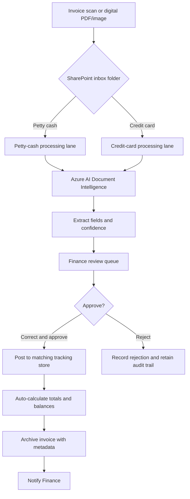
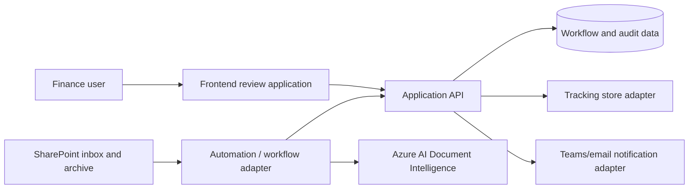

# AI Financial Automation
## Project Understanding and Initial Delivery Blueprint

**Project context:** AgentAiLearn internship · Professor-provided use case  
**Document purpose:** Record the initial shared understanding of the invoice data-capture and financial-sheet automation initiative before implementation begins.  
**Implementation rule:** All application code will be created in `Code/`.

---

## 1. Executive summary

**AI Financial Automation** will reduce manual processing of petty-cash and credit-card invoices for Finance. Today, staff read invoices and enter the values into separate tracking sheets. The stated current effort is approximately **24 staff-hours per week** (two staff members, roughly 12 hours per sheet) and the manual process risks data-entry and calculation errors.

The intended solution receives scanned or digital invoices, extracts structured information using **Azure AI Document Intelligence**, routes the result according to invoice type, and gives Finance staff a review-and-approval experience. Only approved records are written to the appropriate financial tracking store. The original invoice is then archived with searchable metadata.

The target outcome is to reduce recurring manual entry to **less than two hours per week**, focused on exceptions and approval rather than transcription.

## 2. Product name

The recommended website and product title is:

# AI Financial Automation

It is clear, professional, matches the project repository, and remains broad enough to support future financial workflows beyond invoice capture. A suitable page tagline is:

> **Turn invoices into reviewed financial records—automatically.**

## 3. Users and responsibilities

| User / service | Responsibility |
|---|---|
| **Admin Staff (Finance)** | Upload or scan invoices, review AI-extracted values against the source document, correct data where required, and approve or reject entries. The initial direct user group is estimated at two people. |
| **SharePoint** | Receives invoice files, supplies structured archival storage, and hosts or connects to financial tracking data. |
| **Azure AI Document Intelligence** | Reads invoice PDFs/images using a KU-specific trained invoice model and returns structured fields with confidence scores. |
| **Power Automate** | Detects new files, routes workflows, triggers extraction, sends notifications/escalations, writes approved records, and coordinates archival. |
| **Teams / email** | Notifies Finance of newly added rows and (where required) review escalation. |

## 4. Scope and end-to-end workflow

There are two separate processing lanes, and they must remain separate in routing, tracking, and archival:

| Lane | Source inbox |
|---|---|
| Petty cash invoices | `/InvoiceInbox/PettyCash/` |
| Credit card invoices | `/InvoiceInbox/CreditCard/` |

### Processing flow

1. A Finance staff member scans a paper invoice with a mobile scan/camera process, or submits a digital PDF/image, to the designated SharePoint inbox.
2. A new-file trigger detects the document and routes it based on its SharePoint folder.
3. Azure AI Document Intelligence runs the appropriate trained model and returns extracted invoice data and per-field confidence scores.
4. The system creates a review item. Any field below **85% confidence** is visibly flagged for manual attention.
5. Finance staff review the original invoice and extracted values side-by-side, amend individual fields as necessary, then approve or reject the item.
6. An approved invoice is posted to the corresponding petty-cash or credit-card tracking store. Calculations update automatically.
7. The source document is archived in structured SharePoint storage, tagged with searchable metadata. Finance receives a Teams/email notice of newly added records.
8. A review item that is not completed within **24 hours** is escalated.

## 5. Data to capture

The extraction model and review form need to support the following fields:

- Vendor / supplier name
- Invoice date
- Invoice number
- Line items: description, quantity, and unit price
- Total amount
- Tax / VAT amount
- Currency
- Category (where available or selected during review)
- Confidence score **for every extracted field**

The review process must preserve both the AI proposal and the approved/corrected values so that the system can be audited and model quality can be measured later.

## 6. Functional requirements interpreted

| ID | Requirement | Implementation interpretation |
|---|---|---|
| FR-01.1 | Extract named invoice fields and display confidence; flag confidence below 85%. | Store field-level extraction results and scores. Apply a clear review-state indicator whenever at least one required field is below threshold. |
| FR-01.2 | Maintain separate petty-cash and credit-card pipelines; process a new document within five minutes. | Folder-based routing must be explicit, observable, and retryable. Do not infer invoice type solely from AI output. |
| FR-01.3 | Provide a side-by-side review interface with edits and approval. | This is the primary frontend use case. It needs a document viewer, editable structured fields, confidence indicators, review status, and approval/rejection actions. |
| FR-01.4 | Auto-calculate running totals, VAT totals, and month-to-date balance after approved rows. | Calculation rules must be defined centrally and updated only after approval; no manual spreadsheet formulas should be required. |
| FR-01.5 | Archive processed invoices with vendor/date/amount/type metadata. | Archival must retain a source-document link and enable search/retrieval under the KU financial-records retention policy. |

## 7. Frontend-first delivery focus

Because the review experience is the new use case, the first implementation should make that workflow tangible before connecting live cloud services.

### Suggested initial screens

1. **Review queue**
   - Counts for pending, low-confidence, overdue, approved, and rejected items.
   - Filters for invoice type, status, confidence, vendor, date, and overdue reviews.
   - A clear distinction between petty cash and credit card entries.

2. **Invoice review workspace**
   - Source PDF/image viewer on one side and editable extracted fields on the other.
   - Field-level confidence badges and low-confidence highlighting.
   - Editable line items and totals with validation.
   - Approve, reject, save-draft, and audit-history actions.

3. **Tracking / reporting view**
   - Approved records only.
   - Running total, VAT total, and month-to-date views.
   - Search and link back to the archived source invoice.

4. **Operational exceptions view**
   - Processing failures, duplicate candidates, low-confidence invoices, and review items approaching/escalated past 24 hours.

For an early frontend prototype, use realistic local/mock data and clear integration boundaries. The UI should not claim data was posted, archived, or extracted by Azure until the backend confirms it.

## 8. Proposed full-stack shape

The exact framework is still undecided. This logical architecture will let the frontend ship early and allow real Microsoft/Azure integrations to be connected later.

### Recommended domain records

- **Invoice**: ID, type, source-file reference, status, submitted time, processed time, archive reference.
- **Extraction**: model/version, raw result, field confidence, extracted line items, processing error if any.
- **Review**: editable proposed/final values, decision, reviewer, timestamps, rejection reason, escalation state.
- **Posting**: target store, target-row reference, posting timestamp, calculation result/version.
- **Audit event**: immutable event log for upload, extraction, edits, decisions, posting, archival, notifications, and failures.

### Status model

`received → extracting → needs_review → approved → posted → archived`

Terminal/exception states should include at least `rejected`, `failed`, and `escalated`. A low-confidence result is best modeled as a review flag rather than a terminal state, because it still proceeds through human review.

## 9. Business rules and quality safeguards

- A document in `/InvoiceInbox/PettyCash/` must post only to the petty-cash tracking store; a document in `/InvoiceInbox/CreditCard/` must post only to the credit-card store.
- No invoice can be posted until a Finance reviewer approves it.
- Any required field with confidence **below 85%** must be flagged in the review UI.
- Tracking totals and balances update from approved records only.
- The UI should validate amounts, dates, currency, VAT, and invoice-number format before approval where rules are defined.
- Duplicate detection should be designed before production—at minimum, consider invoice number, vendor, amount, date, and invoice type.
- Every correction and approval needs an audit trail linked to its source document.
- Failure states must be visible and retryable; silent workflow failures are unacceptable for financial records.

## 10. Dependencies, assumptions, and open decisions

### Known dependencies

- Azure AI Document Intelligence subscription/procurement.
- A KU-specific custom invoice model, trained with a minimum of **20 petty-cash** and **20 credit-card** sample invoices.
- Power Automate capability; a premium connector may be required if it is not already included in the organization’s Microsoft 365 plan.
- SharePoint locations for inbound files, archives, and potentially tracking data.

### Open decisions requiring confirmation

1. **Tracking store:** SharePoint List or Excel Online. A SharePoint List is generally the safer operational default for structured, concurrent workflow data; Excel may be retained if it is a hard business constraint.
2. **Technical stack:** frontend framework, backend/API platform, database, and authentication/role model.
3. **Field mapping:** exact columns, category taxonomy, line-item handling, VAT rules, and rounding/currency rules.
4. **Retention:** archive retention period, permissions, naming convention, and retrieval process under the KU financial-records policy.
5. **Notifications and escalation:** message templates, recipient groups, owner after 24 hours, and notification failure handling.
6. **Data governance:** although the brief calls this financial operational data rather than personal data, that classification must be confirmed with the DPO/organization.
7. **Operational resilience:** retry limits, manual recovery process, file size/type limits, and duplicate policy.

## 11. Acceptance measures

The first release should demonstrate:

- Separate invoice ingestion and routing for petty cash and credit card.
- Extraction of all specified fields with field-level confidence values.
- Automatic manual-review flagging below the 85% threshold.
- A usable side-by-side review and edit flow, with approvals completed within the 24-hour target and escalation support.
- Approved-only posting into the matching tracking store.
- Automatic running total, VAT total, and month-to-date calculation.
- Searchable, metadata-tagged archived invoice copies.
- Traceability from a tracking row back to its original source invoice and review decision.

## 12. Suggested next implementation steps

1. Confirm the open decisions above with the professor/Finance stakeholders.
2. Collect and classify the required training samples; define an annotation and quality-check process.
3. Define the tracking-store schema and calculation rules, then create a representative set of mock invoices and expected outputs.
4. Build the frontend review queue and side-by-side review workspace in `Code/`, using mock API data first.
5. Establish the backend domain model, approval/audit APIs, and test fixtures.
6. Add adapters for SharePoint, Azure AI Document Intelligence, Power Automate, notifications, and the chosen tracking store.
7. Test low-confidence, invalid, duplicate, failed, rejected, and overdue-review scenarios before production use.

---

**Document status:** Initial discovery and implementation blueprint. It records the supplied requirements and identifies decisions that need stakeholder confirmation; it is not yet a final technical specification.
